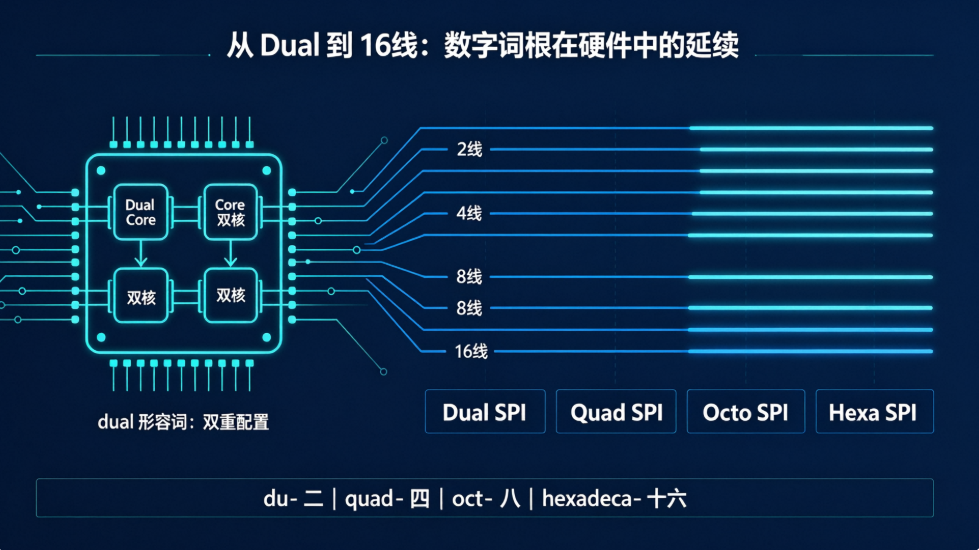
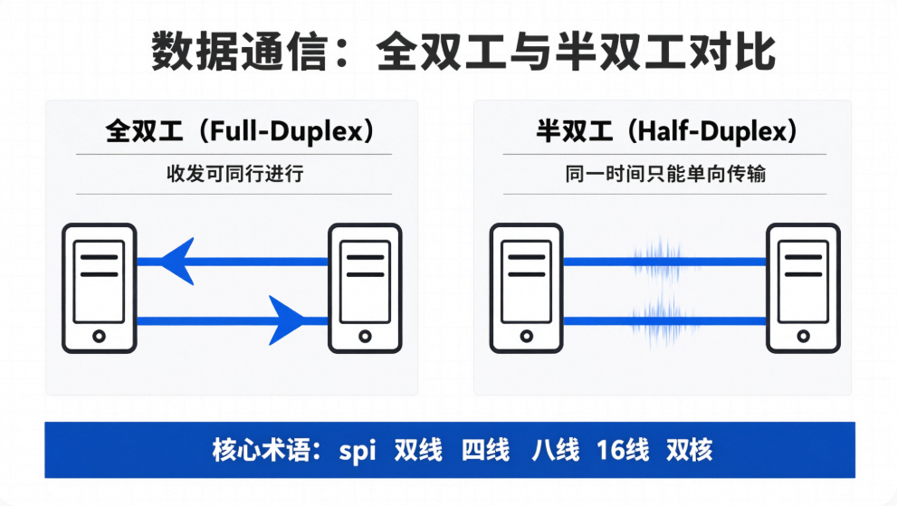

嵌入式科普(56)：从 iPhone Duo 聊聊 `duo`、`dual` 与数字词根
===
[toc]

# 1. iPhone Duo：一个名字为什么有记忆点？

先说明：本文把 **iPhone Duo** 当作一个命名案例来讨论，不代表它是苹果的正式产品名称。

`duo` 发音为 **/ˈduːoʊ/**，中文可近似记作“**杜欧**”。它是名词，表示“两人组、二件组成的一组”。这个词短、好读，又同时包含“两个”和“协同组合”的感觉，所以很适合做品牌名：它讲的是产品故事，不是硬件规格。

# 2. `duo` 和 `dual`：词根相近，词性不同

`duo` 和 `dual` 都可以追溯到表示“二”的拉丁语词源，但不能简单地把它们当作同义词。更准确的区别是：

| 单词 | 发音及中文近似 | 词性 | 核心含义 | 例子 |
| --- | --- | --- | --- | --- |
| `duo` | /ˈduːoʊ/，“杜欧” | 名词 | 两个成员组成的一组 | a musical duo 二人组合 |
| `dual` | /ˈduːəl/，“杜尔” | 形容词 | 双重的、具有两套配置的 | dual-core 双核 |

因此，**`duo` 是“这两个组成的整体叫什么”，`dual` 是“某个东西具有什么双重属性”**。嵌入式里常见的 `dual-core`、`dual-bank`、`dual-port`，都是用 `dual` 修饰后面的名词；它们描述的是硬件结构，而不是给这两个部分起一个组合名。

可以把它们粗略理解为同一“二”的词根家族：`du-` / `duo-` 表示二，但英语中的完整单词还受到词性和历史演变影响。`duplex` 也是这个家族里的成员，表示“二路、双工”。

# 3. 从双线到十六线：SPI 里的数字词根

## 3.1 双线、四线、八线SPI

SPI 的“几线”通常是在说数据 I/O 的并行数量，不能机械地把每一个数字都翻译成 `duo`、`trio` 这样的名词。工程文档更常用下面这些形容词或复合词：

| 数量 | 常见英文 | 中文 | 嵌入式例子 |
| --- | --- | --- | --- |
| 2 | `dual` / `dual SPI` | 双、双线 | dual-core、dual SPI |
| 4 | `quad` / `quad SPI` | 四、四线 | QSPI、quad-core |
| 8 | `octal` / `octa-` | 八、八线 | Octal SPI、octa-core |
| 16 | `16-line` / `hexadecimal`（仅表示十六进制时） | 十六线 | 16-line interface |

这里有一个容易踩的坑：**`hexa-` 通常表示“六”，不是“十六”**；`hexadecimal` 的 `hexadeca-` 才和“十六”有关，而且它主要指十六进制。工程上如果真的是 16 条数据线，写 `16-line` 往往比生造 `Hexa SPI` 更清楚。类似地，`octal` 是“八进制/八路”的常见形容词，`octa-` 更常出现在复合词前。

## 3.2 全双工与半双工

- `full-duplex`：**全双工**，双方可以同时发送和接收。
- `half-duplex`：**半双工**，双方都能发送和接收，但同一时刻只能进行一个方向的传输。

这里的 `duplex` 仍然包含“二路”的意思，但 `full` 和 `half` 决定了这两路能否同时工作。也就是说，“双”描述通道数量，“全/半”描述工作方式。

# 4. 游戏里的 Double Kill、Triple Kill

MOBA 游戏的击杀播报，是数字词根最直观的跨领域例子：

| 次数 | 常见说法 | 词根提示 |
| --- | --- | --- |
| 2 | `Double Kill`，双杀 | `du-` / `dou-` |
| 3 | `Triple Kill`，三杀 | `tri-` |
| 4 | `Quadra Kill`，四杀 | `quad-` |
| 5 | `Penta Kill`，五杀 | `penta-` |
| 6 | `Hexa Kill`，六杀 | `hexa-` |

注意，游戏里的这些说法是固定术语，不必强行套用 SPI 的命名规则。但从 `dual`、`quad` 到 `penta`，确实可以看出“数字词根 + 名词”的构词习惯。掌握一组词根，就能在芯片、通信和游戏界面之间举一反三。

下面的音频可以连续听到“三杀、四杀、五杀”的英文发音：

[播放三杀、四杀、五杀的英文发音](./images/wangzhe.mp4)

# 5. 用 `Duo` 的逻辑给折叠手机起名

小学老师就要求我们具备“举一反三、触类旁通”的能力：学会一个例子，还要能迁移到相近的问题。下面是**本文的命名脑洞，不是厂商官方名称**。每组先看原图，再看改名图；改图只替换产品名称，不增加解释性文字。

## 5.1 华为三折叠：Huawei Trio

原图：

改名图：

`trio` /ˈtriːoʊ/（“**特里欧**”）确实是英语名词，意思是“三人组、三个组成的一组”。它和 `duo` 词性平行：`duo` 是二人组，`trio` 是三人组。因此，三折叠可以趣味命名为 **Huawei Trio**。

## 5.2 小米中折叠：Xiaomi SemiFord

原图：

改名图：

`SemiFord` 不是传统词典里的固定常用名词，而是由 `semi-`（半、居中）和 `fold`（折叠）组成的产品型创意名称。它可以表达“半折叠”或“中折叠”，比 `Duo` 更贴合小米“不做大折叠、也不是小折腾，而是中折叠”的定位。因此本文把它写成 **Xiaomi SemiFord**，读作“**小米·赛米福德**”，仅作为命名创意。

# 6. 小结

1. `duo` 是名词，指两个成员组成的整体；`dual` 是形容词，描述双重属性。
2. `du-`、`quad-`、`octa-`、`penta-` 等数字词根，能帮助我们理解处理器、SPI、双工通信和游戏播报中的词汇。
3. 工程命名首先要准确：两线可写 `dual SPI`，四线常写 `quad SPI`，八线常写 `Octal SPI`；十六线建议直接写 `16-line`。
4. 品牌命名则可以更有故事性：`Duo` 让“两个部分组成一个整体”变得容易记忆，`Trio` 和 `SemiFord` 也因此成为三折叠、中折叠的趣味对应词。小学老师教我们的“举一反三、触类旁通”，正是把一个词根迁移到更多场景。
