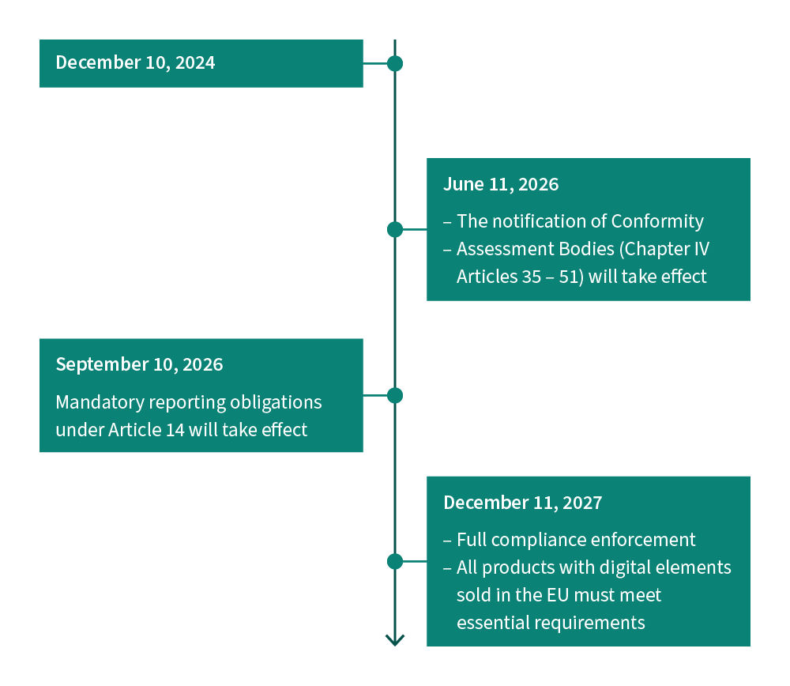
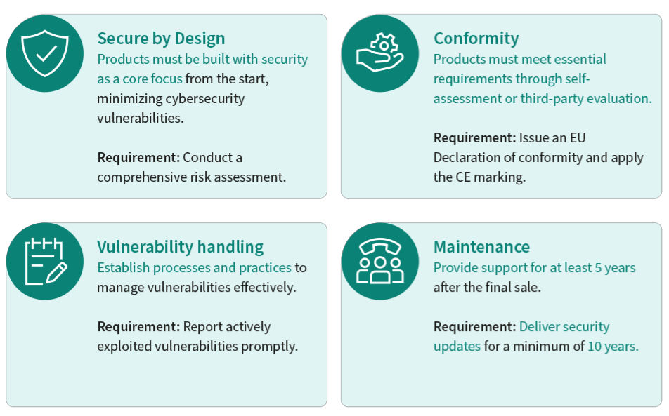

嵌入式科普(59) 欧盟网络弹性法案CRA全面解读与半导体厂商合规应对
===
[toc]


# 1. 前言：为什么所有嵌入式厂商都在谈CRA？

2024年12月10日，欧盟《网络弹性法案》（Cyber Resilience Act，简称 **CRA**）正式在欧盟官方公报发布并生效。这是全球首部针对**所有含数字元素的产品**的横向网络安全立法，覆盖范围远超既有行业法规。

**一句话理解CRA：**

> **凡是带芯片、能联网、在欧盟卖的产品，从2027年12月11日起，必须满足"设计即安全、默认即安全"的强制性网络安全要求，加贴CE标识方可上市。**

CRA直接影响全球半导体产业链：芯片原厂、模组厂商、终端设备制造商、进口商、分销商**全链条担责**。Nordic、Renesas、TI、Infineon、ST、NXP 等主流半导体厂商已在官网设立CRA合规专题页面，向客户传递合规承诺与技术支持方案。

本文结合**欧盟CRA法规原文**与**五大半导体厂商官网CRA专题页面**，系统梳理CRA核心要求、时间线、厂商合规方案及对产业的影响。

**核心结论前置：**
> **CRA不是可选合规，而是市场准入门槛。不合规 = 不能在欧盟卖。2027年12月11日全面实施前，所有面向欧盟市场的数字产品必须完成安全设计改造、漏洞管理流程建设、SBOM生成、CE符合性评定。半导体厂商正在成为下游客户合规的"第一道防线"。**


# 2. CRA法规概览（欧盟官网）

## 2.1 CRA是什么？

《网络弹性法案》（Cyber Resilience Act，Regulation (EU) 2024/2847）是欧盟颁布的**横向网络安全法规**，为所有在欧盟单一市场内销售的、含数字元素的产品制定**基本网络安全要求**。

- **法规编号：** Regulation (EU) 2024/2847
- **发布日期：** 2024年11月20日
- **生效日期：** 2024年12月10日
- **全面实施：** 2027年12月11日
- **法规原文：** https://eur-lex.europa.eu/legal-content/EN/TXT/PDF/?uri=OJ:L_202402847

## 2.2 CRA核心目标

| 目标维度 | 具体内容 |
|----------|----------|
| **统一市场规则** | 消除成员国碎片化网络安全法规，建立统一的CE符合性评定框架 |
| **安全设计强制** | 产品必须"设计即安全"（Security by Design）、"默认即安全"（Security by Default） |
| **全生命周期安全** | 安全要求覆盖设计、开发、生产、上市、运营、维护、退役全周期 |
| **漏洞透明管理** | 制造商发现被利用漏洞后24小时内上报CSIRT/ENISA，72小时内提交修复方案 |
| **供应链透明** | 强制提供SBOM（软件物料清单），声明开源组件与依赖关系 |

## 2.3 CRA适用范围

CRA适用于**所有含数字元素的硬件和软件产品**，能够直接或间接连接设备或网络，且在欧盟单一市场内销售。

**适用产品示例：**
- 智能家居设备（摄像头、门锁、音箱、家电）
- 可穿戴设备、IoT传感器、边缘网关
- 工业控制设备、PLC、HMI
- 网络基础设施设备（路由器、交换机）
- 操作系统、固件、独立软件

**不适用（豁免）领域：**

| 豁免类型 | 原因 |
|----------|------|
| 非商业项目 | 个人开发、科研用途不在监管范围 |
| 无物理组件的纯云服务 | 由NIS2指令覆盖 |
| 汽车 | 由UN-R155/156法规覆盖 |
| 医疗器械 | 由MDR/IVDR法规覆盖 |
| 航空航天 | 由EASA相关法规覆盖 |

## 2.4 CRA产品风险分类

| 类别 | 风险等级 | 符合性评定方式 | 典型产品 |
|------|----------|----------------|----------|
| **默认类（Default）** | 较低 | 制造商自我声明 | 智能音箱、家用传感器、普通IoT设备 |
| **重要类（Class I）** | 较高 | 第三方通报机构评定 | 工业控制设备、网络基础设施、安全设备 |
| **关键类（Class II）** | 最高 | 第三方通报机构评定 | 关键基础设施设备、高端安全产品 |

## 2.5 CRA关键时间线

| 时间节点 | 事件 |
|----------|------|
| **2024年11月20日** | 法规在欧盟官方公报发布 |
| **2024年12月10日** | 法规正式生效 |
| **2026年6月11日** | 第四章（第35–51条）符合性评定机构通报规定开始施行 |
| **2026年9月11日** | 第14条漏洞和事件报告义务开始施行 |
| **2027年12月11日** | CRA主要义务全面实施，所有在欧盟销售的数字产品必须加贴CE标识 |

> **关键提醒：** 2026年9月11日起，制造商发现产品被利用的安全漏洞**必须在24小时内上报**，这意味着漏洞管理流程必须在2026年9月前建设完成。

## 2.6 CRA基本安全要求

CRA附件I规定了产品必须满足的基本网络安全要求，核心可归纳为：

| 要求领域 | 具体要求 |
|----------|----------|
| **安全设计** | 产品不得有已知可利用漏洞；默认配置即安全；最小权限原则 |
| **安全启动** | 确保只有经过授权的软件才能在产品上运行 |
| **安全通信** | 数据传输必须使用加密、完整性保护、认证机制 |
| **安全存储** | 敏感数据（密钥、凭证）必须加密存储、隔离保护 |
| **访问控制** | 防止未经授权的物理和逻辑访问 |
| **安全更新** | 必须支持自动安全更新，更新过程不得引入新漏洞 |
| **漏洞管理** | 建立漏洞发现、评估、上报、修复流程；24小时上报、72小时修复 |
| **SBOM** | 提供软件物料清单，声明所有组件及依赖关系 |
| **日志与审计** | 记录安全相关事件，支持事后调查 |
| **CE标识** | 通过符合性评定后加贴CE标识，出具EU符合性声明 |


# 3. 半导体厂商官网CRA专题汇总

以下为各大半导体厂商官网CRA专题页面的核心内容梳理。所有内容均来自厂商官网公开信息，链接附后。

| 厂商 | 官网链接 | 页面状态 |
|------|----------|----------|
| **Nordic 半导体** | https://www.nordicsemi.cn/protocols/cyber-resilience-act/ | 已抓取 |
| **Renesas 瑞萨** | https://www.renesas.cn/zh/key-technologies/security/cyber-resilience-act-cra | 已抓取 |
| **TI 德州仪器** | https://www.ti.com.cn/zh-cn/technologies/security/cyber-resilience-act.html | 已抓取 |
| **Infineon 英飞凌** | https://www.infineon.cn/quality/security/security-standards/eu-cra | 已抓取 |
| **ST 意法半导体** | https://wiki.st.com/stm32mcu/wiki/Security:Q%26A_for_CRA | 链接超时，无法抓取 |
| **NXP 恩智浦** | https://www.nxp.com.cn/applications/technologies/security/eu-cyber-resilience-act-cra:CYBER-RESILIENCE-ACT | 链接404，无法抓取 |


# 4. Nordic半导体：CRA合规与nRF Cloud

> 官网链接：https://www.nordicsemi.cn/protocols/cyber-resilience-act/

## 4.1 Nordic对CRA的定义

Nordic官网明确指出：CRA为欧盟单一市场内的物联网、智能家居设备及所有数字产品制定了**基本网络安全标准**。CRA强制要求产品"设计即安全"、"默认即安全"，并确保安全贯穿产品全生命周期。

## 4.2 CRA影响的主体

| 主体 | 责任 |
|------|------|
| **制造商** | 产品安全设计、漏洞管理、SBOM、CE符合性评定、技术文档 |
| **进口商** | 验证制造商已履行合规义务、保留符合性声明副本 |
| **分销商** | 确保产品带有CE标识、存储运输条件不影响合规 |

## 4.3 安全设计与维护要求

Nordic将CRA安全要求归纳为：

- **设计即安全：** 产品设计阶段即纳入安全措施，而非事后补丁
- **默认即安全：** 出厂默认配置即为安全状态，无需用户额外设置
- **安全更新：** 必须提供自动安全更新机制，更新周期至少5年
- **漏洞处理：** 发现漏洞后24小时内上报，72小时内提交修复方案
- **SBOM：** 提供软件物料清单，透明声明所有组件

## 4.4 Nordic nRF Cloud助力CRA合规

Nordic强调其 **nRF Cloud** 云服务为设备制造商提供CRA合规所需的关键能力：

| nRF Cloud能力 | 对应CRA要求 |
|---------------|-------------|
| **OTA固件升级** | 安全更新机制（CRA附件I） |
| **设备监控** | 漏洞发现与事件报告（第14条） |
| **生命周期透明性** | 产品维护周期声明、SBOM管理 |
| **安全通信** | 加密传输、设备认证 |


# 5. Renesas瑞萨：CRA五大安全要求

> 官网链接：https://www.renesas.cn/zh/key-technologies/security/cyber-resilience-act-cra

## 5.1 瑞萨对CRA五大要求的归纳

Renesas官网将CRA基本安全要求清晰归纳为**五大技术要求**：

| 序号 | 安全要求 | 说明 |
|------|----------|------|
| 1 | **安全固件更新** | 设备必须支持安全OTA更新，更新包经过签名验证，更新过程不中断设备功能 |
| 2 | **未经授权访问保护** | 防止物理和逻辑层面的未授权访问，包括调试接口保护、权限隔离 |
| 3 | **安全数据存储** | 敏感数据（密钥、凭证、用户数据）加密存储，硬件隔离安全区 |
| 4 | **安全通信** | 所有网络通信使用加密、认证、完整性保护（TLS/IPsec） |
| 5 | **安全启动** | 固件启动链逐级验签，确保只有可信软件运行 |

## 5.2 瑞萨列出的重要日期

| 日期 | 事件 |
|------|------|
| 2024年12月10日 | CRA法规正式生效 |
| 2026年9月11日 | 漏洞和事件报告义务开始施行 |
| 2027年12月11日 | CRA主要义务全面实施 |

## 5.3 瑞萨的合规承诺

Renesas官网明确承诺：
- 瑞萨产品将配合CRA合规要求，提供安全功能支持
- 提供技术文档和安全指南，帮助客户完成CRA符合性评定
- 与安全方案合作伙伴协同，为客户提供端到端合规方案


# 6. TI德州仪器：CRA适用范围与合规承诺

> 官网链接：https://www.ti.com.cn/zh-cn/technologies/security/cyber-resilience-act.html

## 6.1 TI对CRA适用范围的梳理

TI官网详细列出了CRA的适用与不适用范围：

**适用产品：**
- 所有含数字元素、能联网的硬件和软件产品
- 嵌入式处理器、MCU、联网芯片
- 工业控制设备、网络设备

**不适用产品：**

| 豁免领域 | 已有法规 |
|----------|----------|
| 汽车 | UN-R155 / UN-R156 |
| 医疗器械 | MDR (EU 2017/745) / IVDR |
| 航空航天 | EASA法规 |
| 纯云服务 | NIS2指令 |

## 6.2 TI列出的时间轴

| 时间 | 里程碑 |
|------|--------|
| 2024年12月10日 | 法规生效 |
| 2026年9月11日 | 漏洞报告义务生效（第14条） |
| 2027年12月11日 | 主要义务全面实施，CE标识强制 |

## 6.3 TI对产品要求的归纳

TI将CRA对产品的核心要求归纳为：

- **安全设计：** 产品设计阶段纳入安全措施
- **默认安全：** 出厂配置即安全
- **漏洞管理：** 建立漏洞发现、评估、上报、修复全流程
- **SBOM：** 提供软件物料清单
- **CE标识：** 通过符合性评定后加贴CE标识

## 6.4 TI漏洞处理过程

TI官网描述了CRA要求的漏洞处理流程：

```
漏洞发现 → 24小时内上报CSIRT/ENISA → 评估影响 → 72小时内提交修复方案 → 发布安全更新 → 闭环验证
```

## 6.5 信息和标记要求

TI强调CRA对产品信息和标记的要求：
- **CE标识：** 产品必须加贴CE标识
- **数字产品护照：** 提供产品安全相关信息
- **SBOM：** 声明软件组件清单
- **安全更新信息：** 声明更新支持周期（至少5年）

## 6.6 TI的网络安全承诺

TI官网强调其在网络安全方面的长期承诺：

| 承诺维度 | 具体内容 |
|----------|----------|
| **TÜV SÜD认证** | TI的网络安全流程通过TÜV SÜD认证 |
| **PSIRT** | 设立产品安全事件响应团队，负责漏洞接收、评估、响应 |
| **安全开发生命周期** | 遵循安全开发流程，从设计阶段纳入安全 |
| **客户支持** | 提供CRA合规技术支持和指导 |


# 7. Infineon英飞凌：设计即安全与全产品线合规

> 官网链接：https://www.infineon.cn/quality/security/security-standards/eu-cra

## 7.1 英飞凌CRA核心主张

英飞凌官网以**"今日筑牢安全，明日从容合规"**为核心主张，依托**"设计即安全"（Design for Security）**解决方案，帮助客户打造满足CRA要求的联网设备。


> 英飞凌CRA专题页头图：以"今日筑牢安全，明日从容合规"为核心主张。

## 7.2 CRA对您意味着什么？

英飞凌官网原文：

> 《欧盟网络弹性法案》（CRA）为欧盟单一市场内的物联网、智能家居设备及所有数字产品制定了基本网络安全标准。CRA强制要求产品"设计即安全"、"默认即安全"，并确保安全贯穿产品全生命周期。

**适用范围：** 大多数包含数字元素的硬件和软件

**不适用：**
- 非商业项目
- 无物理组件的云服务
- 汽车、医疗保健和航空等行业（已受相关法规规范）

## 7.3 CRA施行时间



> 英飞凌官网展示的CRA关键时间轴：2024年12月10日生效 → 2026年9月11日漏洞报告 → 2027年12月11日全面实施。

## 7.4 制造商责任



> 英飞凌官网展示的CRA规定的制造商责任图：覆盖安全设计、漏洞管理、SBOM、CE标识、生命周期维护等全链条义务。

## 7.5 英飞凌的CRA合规承诺

英飞凌官网明确承诺：

> 英飞凌致力于帮助客户不仅满足CRA合规要求，更将其转化为增长引擎，助力客户在各自行业中占据市场领先地位。

**英飞凌的独特优势：**
- 在多个对CRA具有重要影响的委员会中担任重要角色
- 提供覆盖全产品线的合规对标方案
- 提供实用工具及独到洞察，让合规落地化繁为简

## 7.6 英飞凌CRA合规支持体系

英飞凌提供五大板块的CRA合规支持：

| 板块 | 内容 |
|------|------|
| **01 欧盟CRA入门指南** | 精选核心资源：专家洞见、实用工具、可落地的合规指引 |
| **02 专家洞见** | 网络研讨会、播客：解读CRA核心要求、标准化进展、合规策略 |
| **03 产品与CRA合规类别对标** | 英飞凌全产品线与CRA合规类别对照表 |
| **04 常见问题** | CRA实施时间、适用范围、不合规处罚、标准制定等FAQ |
| **05 资料中心** | CRA法规原文、白皮书、技术文档 |

## 7.7 英飞凌CRA关键FAQ

| 问题 | 回答 |
|------|------|
| **CRA何时正式实施？** | 2027年12月11日全面实施；2026年6月11日符合性评定机构通报规定施行；2026年9月11日报告义务施行 |
| **CRA涵盖哪些设备？** | 所有在欧盟单一市场内销售的、配备硬件和软件的联网数字设备和组件 |
| **不合规面临何种处罚？** | 制造商可能被处以巨额罚款及其他处罚 |
| **谁来制定技术标准？** | 欧洲标准化组织 CEN-CENELEC 和 ETSI 负责制定协调欧洲标准 |
| **如何确保设备合规？** | 查阅欧盟指南及法规文件，与英飞凌等安全专家合作 |
| **CE符合性测试目录何时完成？** | CENELEC制定，部分领域测试目录初稿预计2025年底前出炉 |


# 8. ST意法半导体与NXP恩智浦

## 8.1 ST意法半导体

ST在STM32 Wiki上设立了CRA专题页面：
- **CRA问答页：** https://wiki.st.com/stm32mcu/wiki/Security:Q%26A_for_CRA
- **CRA深度解读：** https://wiki.st.com/stm32mcu/wiki/Security:Deep_dive_on_CRA

> 注：截至本文编写时，上述Wiki链接访问超时，未能获取页面内容。ST作为STM32全球最大MCU供应商，其CRA合规方案对下游客户影响重大，建议关注ST官方渠道的最新更新。

## 8.2 NXP恩智浦

NXP中文官网设立了CRA专题页面：
- **CRA专题页：** https://www.nxp.com.cn/applications/technologies/security/eu-cyber-resilience-act-cra:CYBER-RESILIENCE-ACT

> 注：截至本文编写时，上述链接返回404错误，页面可能已迁移或下线。NXP作为车规芯片和工业MCU主要供应商，其CRA合规方案建议关注NXP官方渠道的最新更新。


# 9. 五大厂商CRA合规对比

| 维度 | Nordic | Renesas | TI | Infineon |
|------|--------|---------|-----|----------|
| **官网专题页** | 有 | 有 | 有 | 有 |
| **安全要求归纳** | 设计即安全、默认即安全 | 五大技术要求 | 安全设计+漏洞管理+SBOM | 设计即安全 |
| **时间线梳理** | 有 | 有 | 有 | 有 |
| **适用范围说明** | 有 | 有 | 有（含豁免） | 有（含豁免） |
| **漏洞处理流程** | 24h上报+72h修复 | 有 | 24h上报CSIRT+72h修复 | 有 |
| **合规工具/服务** | nRF Cloud OTA/监控 | 合作伙伴方案 | TÜV SÜD认证+PSIRT | 全产品线对标+专家洞见 |
| **标准化参与** | — | — | — | CRA委员会重要角色 |
| **客户支持方式** | 云服务赋能 | 技术文档+指南 | 技术支持+PSIRT | 入门指南+网络研讨会+播客 |
| **独特优势** | nRF Cloud一站式合规 | 五大要求清晰归纳 | TÜV SÜD流程认证 | 标准化委员会深度参与 |


# 10. CRA对企业、研发与用户的影响

## 10.1 对企业的影响

| 影响维度 | 具体影响 |
|----------|----------|
| **市场准入** | 2027年12月11日后，不合规产品无法在欧盟市场销售，CE标识成为硬门槛 |
| **合规成本** | 安全设计改造、漏洞管理流程建设、SBOM工具链、第三方符合性评定，均需投入 |
| **供应链责任** | 制造商、进口商、分销商全链条担责，需向上游索取合规证据、向下游传递合规信息 |
| **产品生命周期** | 必须声明安全更新支持周期（至少5年），影响产品退役策略 |
| **违规处罚** | 不合规可被处以巨额罚款及产品下架、市场禁入等处罚 |
| **竞争格局** | 合规能力成为竞争壁垒，先行合规者获得市场先发优势 |

## 10.2 对研发的影响

| 影响维度 | 具体影响 |
|----------|----------|
| **安全设计前置** | 安全从"事后补丁"变为"设计即安全"，需在架构阶段纳入威胁建模、安全分析 |
| **安全功能要求** | 安全启动、安全通信、安全存储、访问控制、安全更新成为标配功能 |
| **漏洞管理流程** | 必须建立PSIRT/CSIRT，漏洞发现→评估→上报→修复→发布全流程 |
| **SBOM工具链** | 必须建立软件物料清单生成与管理工具链，声明所有组件及依赖 |
| **文档与审计** | 需编制技术文档、符合性声明、安全评估报告，支持CE评定审计 |
| **开发流程改造** | 引入SSDLC（安全软件开发生命周期），代码审查、安全测试常态化 |

## 10.3 对用户的影响

| 影响维度 | 具体影响 |
|----------|----------|
| **产品安全性提升** | 所有在欧盟销售的数字产品默认达到基本安全标准，用户无需自行加固 |
| **漏洞透明度** | 制造商必须公开漏洞处理情况，用户可知情决策 |
| **安全更新保障** | 产品至少5年内可获得安全更新，降低长期安全风险 |
| **CE标识信任** | CE标识成为产品安全可信的标志，降低用户选购风险 |
| **隐私保护增强** | 安全通信、安全存储要求间接增强用户数据隐私保护 |


# 11. CRA合规行动建议

## 11.1 时间紧迫性

> **从现在到2027年12月11日，只有约15个月窗口期。** 考虑到安全设计改造、漏洞流程建设、第三方评定周期，实际留给产品改造的时间更为紧迫。

## 11.2 分阶段行动建议

| 阶段 | 时间 | 行动 |
|------|------|------|
| **阶段一：评估** | 立即 | 梳理产品线，确定CRA适用范围与风险类别（默认/重要/关键） |
| **阶段二：差距分析** | 2025Q4 | 对照CRA附件I基本要求，分析现有产品安全能力差距 |
| **阶段三：安全改造** | 2026Q1–Q3 | 安全启动、安全通信、安全存储、访问控制、安全更新功能开发 |
| **阶段四：流程建设** | 2026Q1–Q2 | 建立漏洞管理流程、PSIRT、SBOM工具链、SSDLC |
| **阶段五：漏洞上报就绪** | 2026年9月前 | 漏洞上报流程就绪，对接CSIRT/ENISA |
| **阶段六：符合性评定** | 2027Q1–Q3 | 完成CE符合性评定（自我声明或第三方通报机构评定） |
| **阶段七：全面合规** | 2027年12月11日前 | 所有产品加贴CE标识，出具EU符合性声明 |

## 11.3 半导体厂商选型建议

在CRA合规背景下，芯片选型应增加安全维度考量：

| 选型维度 | 建议关注点 |
|----------|------------|
| **安全硬件能力** | 硬件隔离安全区（TrustZone/SE）、安全启动支持、加密加速引擎 |
| **安全固件支持** | 厂商是否提供安全OTA方案、是否有CRA合规技术支持 |
| **SBOM支持** | 厂商是否提供芯片级SBOM、开源组件声明 |
| **漏洞响应** | 厂商是否有PSIRT、漏洞响应SLA、安全更新承诺周期 |
| **合规文档** | 厂商是否提供CRA合规指南、安全评估报告 |
| **合规生态** | 厂商是否有合规合作伙伴、第三方评定支持 |


# 12. 总结

CRA是全球首部针对所有数字产品的横向网络安全立法，其影响深远：

1. **市场准入重构：** CE标识从"自愿性安全声明"升级为"强制性网络安全门槛"，不合规即不能在欧盟市场销售。

2. **安全范式转变：** 从"事后补丁"到"设计即安全"，安全成为产品设计的起点而非终点。

3. **全链条责任：** 芯片原厂、设备制造商、进口商、分销商全链条担责，半导体厂商成为下游合规的第一道防线。

4. **时间窗口紧迫：** 2026年9月漏洞上报义务生效，2027年12月全面实施，留给产业改造的时间不足15个月。

5. **厂商积极应对：** Nordic、Renesas、TI、Infineon等主流半导体厂商已全面布局CRA合规支持，从安全硬件能力、合规工具链、技术文档到标准化参与，为客户提供端到端合规赋能。

> **CRA不是合规终点，而是安全新纪元的起点。** 对嵌入式产业而言，谁能率先完成安全能力建设与合规改造，谁就能在欧盟市场乃至全球市场占据先发优势。
